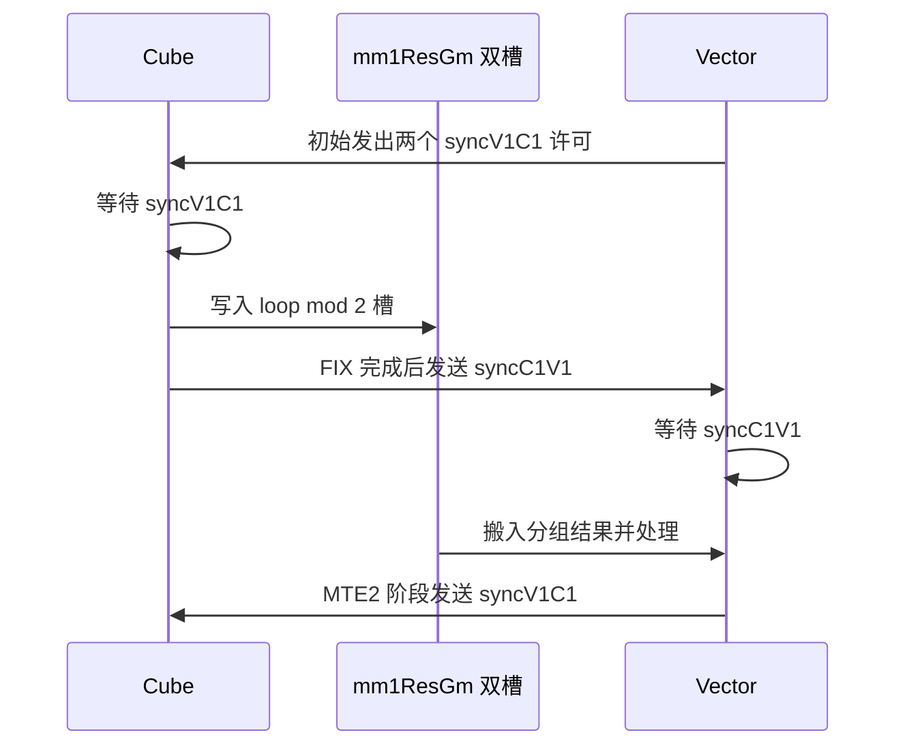

# LightningIndexer 在 CANN 9.0.0 上如何组织打分与 TopK

LightningIndexer 为每个 Query token 选择重要的 KV 位置。这个案例的核心不是调用一次 TopK，而是把 Index Query 与 Index Key 的矩阵乘、ReLU、分组加权归约、分块排序和跨核归并组织成一个内核。它展示了 A2/A3 上很典型的一类问题：Cube 已经算得快，Vector 的排序与中间数据周转却会限制整个算子的推进速度。

本文分析 CANN 正式配套标签 `v9.0.0`，固定提交 `afe72144f9f2ac8441929035795db88a111b30c5`。该算子的产品表支持 A2/A3 训练和推理系列，Host 的 `GetNpuInfo` 也明确接受 `ASCEND910B` 与 `ASCEND910_93`；950 在产品表中不支持。[版本配套](https://gitcode.com/cann/release-management/blob/c847330e202fbe9e724ef36c6219e49f42cda312/9.0.0/release-notes.md)、[算子约束](https://gitcode.com/cann/ops-transformer/blob/afe72144f9f2ac8441929035795db88a111b30c5/attention/lightning_indexer/README.md)、[Host 检查](../code/upstream/attention/lightning_indexer/op_host/lightning_indexer_tiling.cpp)

这是一个有完整 Kernel、Tiling 和调用样例的源码实战案例。这里不附加速倍数：公开材料没有给出同时固定该版本、shape 和基线的优化前后表。本机也没有 NPU。下面的访存量、分块次数和并行关系是对固定源码的分析。

## 先确定计算与规格

对一个 token，Query 为 `Q[g,128]`，共享的 Key 为 `K[S2,128]`，权重为 `w[g]`，最终分数是：

\[
a_j=\sum_{h=0}^{g-1} w_h\max\{Q_hK_j^T,0\},\qquad I=\operatorname{TopK}(a).
\]

源代码支持 FP16/BF16 输入，权重还可以是 FP32。Query head 数不超过 64，Key head 数为 1，head dimension 固定为 128。布局支持 BSND/TND，Key 另外支持 PA_BSND。因果模式采用右下角对齐的限制，不能直接套用 `j <= i` 的方形 causal mask。

以 `B=1, S1=1, S2=8192, g=64, sparse_count=2048` 为阅读规格。若将整个打分矩阵物化，单 token 的 `64 × 8192` FP32 元素就是 2 MiB；之后还要处理权重和排序。优化实现采用 `S2_BASE_SIZE=512`，将长 Key 轴拆成 16 个基本块，并在处理过程中维护有界候选列表。具体常量和尺寸关系见 [Kernel 初始化](../code/upstream/attention/lightning_indexer/op_kernel/lightning_indexer_kernel.h) 与 [公共定义](../code/upstream/attention/lightning_indexer/op_kernel/lightning_indexer_common.h)。

## 分核先解决单 token 的并行度

`LIPreload::GetTotalBaseBlockNum` 统计各 Batch 实际有效的 `(S1,G)` 与 S2 基本块，因果场景按有效三角区域计数。`SplitCore` 再将展开的任务序列按块数平均分配：前若干核多分一个块，其余核取商。核得到的是起止坐标，可能同时跨 Batch、Query 基本块和 S2 基本块。

这比只沿 Batch 或 Query 轴分核更适合 Decode：`B=1, S1=1` 仍可以把 16 个 S2 基本块分给多个 Cube 核。代价是同一 token 的候选分散在不同核上，最后必须归并。`SplitCore` 用 `isLD` 标记承担后续归并的核，归并责任交给覆盖该 S2 行开头的核。

`sparse_count > 2048` 是一个不同分支。`s1BaseSize` 会根据候选数缩小，分核时将一行的 S2 计算视为一项任务，避免按普通 2K 候选路径做跨核局部候选归并。讨论四块缓存和 `ProcessLD` 时，需要保留这个条件。

## ReLU 在 Cube 输出阶段完成

`LIMatmul::ComputeMm1` 手工组织 GM→L1→L0A/L0B→L0C 的搬运和矩阵乘。`Mmad` 的结果通过 `Fixp` 转成 ND 并写入 FP32 workspace。`Fixp` 中的 `reluPre=1` 在这个阶段完成 ReLU，所以 Vector 读取的已经是非负打分矩阵；后续权重可以为负，归约后的最终分数仍可能为负。

这一步省去单独 Vector ReLU 对整块结果的读写。不能把公式中的 ReLU 随意移到权重乘法或 group 归约之后，因为负权重存在时结果会改变。[Cube 实现](../code/upstream/attention/lightning_indexer/op_kernel/lightning_indexer_service_cube.h)

## GM Double Buffer 配合反向同步

`Init` 为每个 Cube 分配两份 `mm1ResGm`，地址按 `loop % 2` 切换。每份大小为 `mBaseSizeAlign × 512 × sizeof(float)`。普通 2K 候选路径的 `s1BaseSize=8`，当 `g=64` 时 `mBaseSizeAlign=512`，两份 workspace 合计 2 MiB 每 Cube 核；实际尾块可能只算一部分，但地址预留仍按基本块尺寸。

`ProcessBaseBlock` 的协议可以概括为：

初始两个许可使 Cube 可以推进到另一个槽。Vector 在 GM 数据已经由 MTE2 消费之后归还许可，Cube 才可以复用对应的槽；排序在 UB 中继续处理。这个反向同步保护的是数据生命周期，不是单纯“多加一个 Flag”。若只保留生产完成信号而删去复用许可，下一轮可能覆盖尚未搬完的数据。主入口结束后还会回收两个许可，保证尾部流水收敛。[workspace 与同步](../code/upstream/attention/lightning_indexer/op_kernel/lightning_indexer_kernel.h)

## Vector 内部再分两种工作

同一 Cube 对应的两个 AIV 按 Query token 分工：偶数 AIV 取 `ceil(S1/2)`，奇数 AIV 取剩余部分。对单 Query token，后者的有效 Query 工作量可能为零；“有两个 AIV”不等于每个 shape 都会平均用满两个 AIV。

`ProcessVec` 沿 group 切成 `groupInner_` 的小块，`tmpUb_` 按 ping/pong 搬入打分和权重。`DoScale` 将权重广播，先乘到缓存上，后续 group 小块继续累加；`DoReduce` 对缓存行做二分加法归约。score 和 index 随后组织成排序需要的成对布局，无效尾部填 `-inf` 与 `-1`，避免 padding 混入有效 TopK。[Vector 主逻辑](../code/upstream/attention/lightning_indexer/op_kernel/lightning_indexer_service_vector.h)、[广播归约与排序工具](../code/upstream/attention/lightning_indexer/op_kernel/lightning_indexer_vector.h)

这里还能看到一个细节：归约缓存前额外留出 256 字节，常量名为 `REDUCE_BANK_CONFLICT_OFFSETS`。这是特定缓冲布局的调整，不应脱离源代码直接推导成“所有 Reduce 加 256 字节都更快”。

## 小 S1 分支把四个 512 块攒起来再归并

普通路径对每个 512 基本块执行 `SortAll`，再用 `MergeSort` 与当前候选列表归并。对 `actS1Size <= 4` 且 `sparse_count <= 2048` 的分支，源码采用另一种策略：

1. 将当前块的排序结果写入 `SortedBasicBlock_`，槽号是 `(s2Idx - blockS2StartIdx_) % 4`。
2. 满四块、S2 到末尾或当前核任务到末尾时，调用 `MrgBasicBlock` 做精排。
3. 第一组最多 `4 × 512 = 2048` 个候选直接建立 `globalTopkUb_`。
4. 之后每组先完成组内精排，再用 `SparseTopK` 与已有 2048 候选合并。

这个优化减少了与大候选列表归并的频率，适合 Query 很少、S2 很长的形状。它仍需对每个基本块做排序，不能将其解释为“每四轮才排序一次”。`Sort` 后的局部有序结果与 `MrgBasicBlock` 的精排也不是同一阶段。

缓存只在小 S1 上使用有明确资源原因：每个 AIV 最多处理两条 Query 行，才能容纳相应的四块缓存。`sparse_count > 2048` 的候选列表更大，也切回即时归并路径。由此可以看到，优化分支的选择是 shape 与 UB 容量共同决定的，不是一个全局开关。

## 跨核 TopK 只交换候选和边界信息

如果当前核完整处理了该 token 的 S2，`ProcessVec` 可以直接输出索引。如果 S2 跨核切分，则把头部或尾部候选写入 `vec1ResGm`，把是否需要归并、是否为 S2 末尾、输出地址等写入 `vec1ParamGm`。所有 Vector 核经 `SyncAll` 后，只有 `isLD` 核执行 `ProcessLD`。

`ProcessLD` 从自身尾部候选开始，依次读取后续核的头部候选。每收集四条 2048 有序列表，就通过 `MrgSort` 合并，并仅保留前 2048 个成对候选。不到四条的尾部用 `validBit` 控制参与列表，最后抽取 index，按 `sparse_count` 写出。

局部 TopK 足以构成全局 TopK：若一个元素已被本分片内至少 K 个元素压在后面，它就没有必要进入全局前 K。实际实现还必须处理相等分数、无效索引和短分片；正确性检查不能要求任意 tie 的索引顺序与 CPU `topk` 完全相同。[局部 workspace 写出与跨核归并](../code/upstream/attention/lightning_indexer/op_kernel/lightning_indexer_service_vector.h)

## 可以怎样做有意义的复现实验

先用完整上游工程构建该算子，跑 aclnn 示例和 Host/API UT，再使用本目录的 `benchmark.py` 验证 BSND、无 causal mask 的单算子输出与参考 score。该脚本是新增复现辅助工具；Kernel 和 Tiling 快照保持上游原样。

最直接的消融实验是四块缓存：在另一个上游工作副本中，仅将 `ProcessVec` 的 `if (info.actS1Size > 4 || constInfo_.isSparseCountOver2K)` 改为始终进入原本的即时归并分支，保留其他代码与缓冲分配。分别在 `S1=1/2/4`、`S2=8192/32768`、`sparse_count=2048` 上对比耗时与输出；再用 `S1=8` 作为原分支不启用缓存的对照。这个对比测的是归并节奏差异，不能据此声称减少了整个算子的 workspace。

Double Buffer 的消融要同时调整槽索引、workspace 和初始许可数，单独改 `%2` 或删一个 Flag 都会破坏协议。建议先用 msProf 查看 Cube FIX、Vector MTE2、排序与等待的时间关系，再决定是否值得改动。性能记录至少包括 CANN/驱动、SoC、精度、B/S1/S2/g/K、有效序列长度、布局、warmup、计时方法及精度检查结果。具体命令和检验边界见 [复现说明](reproduce.md)。

读完这个 Kernel 最可迁移的经验，是围绕候选列表和结果槽的生命周期设计流水：用 S2 分核获得并行度，用有限局部 TopK 控制交换量，再按 UB 能容纳的工作集决定即时归并还是批量归并。
