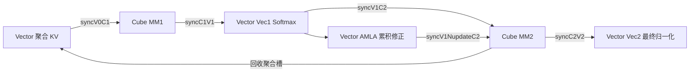

# SparseFlashAttention 在 CANN 9.0.0 上如何聚合离散 KV

DeepSeek 的稀疏 Attention 只使用一部分 KV，但被选中的 token 往往散落在 KV Cache 中。减少矩阵乘 FLOPs 后，逐 token 查索引和发出小搬运指令可能成为主要成本。SparseFlashAttention 的实战价值就在这里：它保留两条不同的搬运路径，将细粒度稀疏 KV 先聚合，再用 Cube 与 Vector 的流水推进 MM1、在线 Softmax 和 MM2。

本文固定正式配套标签 `v9.0.0`，提交 `afe72144f9f2ac8441929035795db88a111b30c5`，主要复现目标为 **Atlas A2 推理系列 / Ascend 910B**。上游产品表还写支持 A3 推理，但同一快照的 `SFAInfoParser::GetNpuInfo` 仅接受 `ASCEND910B`；A3 源码复现存在需要上游确认的差异。这里不将 A3 无条件编译运行列为已经证实的结论。950 不属于本文路径。[正式版本映射](https://gitcode.com/cann/release-management/blob/c847330e202fbe9e724ef36c6219e49f42cda312/9.0.0/release-notes.md)、[产品与参数表](https://gitcode.com/cann/ops-transformer/blob/afe72144f9f2ac8441929035795db88a111b30c5/attention/sparse_flash_attention/README.md)、[Host 实现](../code/upstream/attention/sparse_flash_attention/op_host/sparse_flash_attention_tiling.cpp)

这个案例提供完整源码，能检查搬运、缓冲和同步的实际实现。本文不引用 SFAG 的 2x～6x 宣传数字：那是梯度算子，也不构成本前向算子的优化前后成绩。没有经过相同 CANN、shape 和基线条件的实测，就不能给这个 Kernel 附加一个加速倍数。

## 从 MLA Absorb 规格看真正的代价

此版本支持 `attention_mode=2`，即 MLA Absorb。非 RoPE 的 head dimension 为 512，RoPE dimension 为 64，KV head 数为 1，Query head 数可以为 1 到 128 的指定二次幂。输入使用 FP16/BF16，MM1/MM2 的结果与在线统计使用 FP32。对每个 Query token，从 `sparse_indices` 指定的 token 或块取出 KV，计算：

\[
x_j=s\left(q_{\mathrm{nope}}k_{j,\mathrm{nope}}^T+q_{\mathrm{rope}}k_{j,\mathrm{rope}}^T\right),\qquad
o=\frac{\sum_j e^{x_j}v_j}{\sum_j e^{x_j}}.
\]

Absorb 路径中 value 与 Key 的压缩部分共享数据。RoPE 只参与打分，MM2 的输出维度仍为 512。不能把 512 与 64 的数据拼在一起之后，连 value 的维度也一并改为 576。

以 `S2=8192, sparse_count=2048, sparse_block_size=1` 为例，计算只访问 2048 个选中 token；每个 token 至少涉及 512+64 个 FP16/BF16 元素。若每个 token 各发出一次压缩 Key 搬运和一次 RoPE 搬运，仅搬运指令的组织就会很重。数据是否连续、PageAttention 的页映射是否打散，会明显改变代价。

## Host 根据稀疏粒度选择两条路径

`SFAMlaTiling::InitParams` 对 `s2Size != 0 && sparseBlockSize <= 4` 选择 `V_TEMPLATE_MODE`，其余选择 `C_TEMPLATE_MODE`。`CalcInnerSize` 默认采用 512 大小的 S2 基本块，再受实际长度与对齐约束调整。也就是说，细粒度稀疏和较大连续块的处理方式并不相同。[Tiling 参数选择](../code/upstream/attention/sparse_flash_attention/op_host/sparse_flash_attention_tiling.cpp)

| 路径 | 关键实现 | 代价与用途 |
|---|---|---|
| V_TEMPLATE | Vector `MergeKv` 先聚合到 GM，Cube 连续读聚合结果 | 增加聚合 workspace 的写入和读取，换取更规则的 Cube 搬运 |
| C_TEMPLATE | Cube 根据 sparse index 或 PageAttention 映射直接搬入 L1 | 少一次 GM 中转，适合原本就有较大连续块的稀疏规格 |

V_TEMPLATE 并不是“把全部 KV 压紧一次，以后所有 Query 复用”。它处理当前 Query 的当前 S2 基本块，每轮最多组织这一块的选中 KV，workspace 循环复用。不同 Query 的选择集合可以不同。

## MergeKv 的优化单位是成对稀疏块

`GetRealS2Idx` 将稀疏列表中的块号还原成真实 token 索引。`GetKeyGmOffset` 处理 causal 边界和 PageAttention 页表映射，非法位置返回 `-1`。两个 AIV 按成对稀疏块划分当前 S2 工作量，各自执行 `MergeKv` 的一部分。

`CopyInKv` 每次处理两个稀疏块。若两块的源地址可以表达成非负、未溢出的 stride，且没有有效长度尾部截断，就把它们组织成带 `blockCount` 和 `srcStride` 的一次压缩 Key 搬运，再做一次相应的 RoPE 搬运；较低源地址先读入。若 stride 非法或触及边界，则退回 `CopyInSingleKv` 的两次独立搬运。

这不是简单地寻找“相邻 token”。即使两块源地址不相邻，只要 DMA 的 stride 能表达，也可以在一条多块搬运指令中处理。每对 Key 与 RoPE 的相对顺序必须相同；Attention 对选中集合的排列不敏感，但不能只重排 K 而不重排对应的 V。

聚合 UB 的 ping/pong 区每份可放 32 个 token 的压缩 Key，RoPE 使用对应区域。读入数 `mte2Size` 与已写出数 `mte3Size` 的差接近这个容量时，`CopyOutMrgeResult` 将数据写入连续 workspace，再切换缓冲。`MTE3_MTE2` 反向事件防止下一批读入覆盖尚未写出的区域，`MTE2_MTE3` 确保写出读取到已经搬入的数据。[离散 KV 聚合](../code/upstream/attention/sparse_flash_attention/op_kernel/sparse_flash_attention_service_vector_mla.h)

## 为什么聚合 workspace 有四槽

`kvMergeGm_` 按 `loop % 4` 使用四个槽，每槽预留 `512 × (512+64)` 个输入精度元素。FP16/BF16 下合计约 2.25 MiB 每个 Cube 核。每槽里压缩 Key 和 RoPE 分区存放，同时 `kvValidSizeGm_` 保存两个 AIV 各自搬入的有效长度。Vector 将无效尾部补零，后面的 score 处理还需要根据有效长度屏蔽这些位置，补零本身不能代替 Softmax mask。

`ProcessBalance` 在开始时给四个聚合槽发出四份回收许可。Vector `MergeKv` 前等待 flag 3，写出完成后发 `syncV0C1`；Cube 在 `ComputeMm1` 前等待该信号。对应数据会被 MM1 当作 K，也会被下一阶段的 MM2 当作 V，因此槽的回收发生在 MM2 消费之后，而不是 MM1 一结束就复用。[初始化与流水](../code/upstream/attention/sparse_flash_attention/op_kernel/sparse_flash_attention_kernel_mla.h)、[Cube 聚合数据读取](../code/upstream/attention/sparse_flash_attention/op_kernel/sparse_flash_attention_service_cube_mla.h)

这点解释了“聚合缓存四份”和“MM 结果 Double Buffer 两份”为什么能够同时存在：它们保护的对象、消费者和回收时刻不同。把所有缓存统一改成两份，需要重新证明每条依赖，不能只做内存尺寸替换。

## 三个任务记录承载两轮延迟的流水

`PRELOAD_NUM=2`，但 `RunInfo extraInfo` 的环形数组大小为 3。`PreloadPipeline(loop)` 同时处理当前、上一轮和上两轮的任务：

| 任务 | Cube | Vector |
|---|---|---|
| 当前 t | MM1，生成 QK score | V_TEMPLATE 的稀疏 KV 聚合 |
| 上一轮 t−1 | 等待 P 后执行 MM2，累加 PV | Vec1：缩放、mask、在线 Softmax、AMLA 重标度 |
| 上两轮 t−2 | 已完成 MM2 | Vec2：需要最终输出时归一化并写出 |

这是逻辑阶段关系，不表示同一轮内所有框一定同时执行。实际推进受 cross-core flags、MTE 事件以及同一个 Cube 的 MM1/MM2 排程约束。`ProcessBalance` 在当前核最后一项任务后额外执行两轮，以排空还留在流水里的任务；如果删去尾部 `extraLoop=2`，末尾输出将缺少后续阶段。

反向 `syncC2V1` 还保护 Vec1 对累计 MM2 结果的更新。该实现将在线累计的写入与下一次 Cube Fixpipe 的原子累加配合起来，不能只按前向的数据依赖删减同步。

## 在线 Softmax 与 AMLA 的数值处理

`SoftmaxFlashV2Compute` 从上一 S2 块的 max/sum 继续更新，第一块使用默认值。传统在线 Attention 的稳定形式可写为：

\[
m_t=\max(m_{t-1},\max x_t),\quad
\ell_t=e^{m_{t-1}-m_t}\ell_{t-1}+\sum e^{x_t-m_t},
\]

\[
u_t=e^{m_{t-1}-m_t}u_{t-1}+\sum e^{x_t-m_t}v_t,\qquad o=u_T/\ell_T.
\]

这是理解流式归约的数学模型。源码的 `AmlaVecCompute` 还为 MM2 输入精度与累计结果构造了指数尺度及补偿因子，不是逐字实现上面的 FP32 公式。它用 `n(i)=round(-max/ln 2)`、前后指数差、输入精度 Cast 往返得到的系数来生成 `nUpdate`。`ProcessAmlaNupdate` 将这个 INT32 更新广播，并通过 `SetAtomicAdd<int32_t>` 作用到累计结果的位表示；Cube 最后以 FP32 `SetAtomicAdd<MM_OUT_T>` 写入新的 PV 贡献。

首块把累计结果初始化为源码给定的 `2^-80` FP32 位模式。最终 `DealBmm2ResBaseBlock` 读取累计结果，执行数值过滤和按行除以 `aMlaSumUb`，再转换输出。这些操作解释了为什么修改 Softmax、Cast 或原子累计时必须同时检查精度与同步，不能把整数位更新直接移植到任意 FP32 归约。[Softmax 与 AMLA 处理](../code/upstream/attention/sparse_flash_attention/op_kernel/sparse_flash_attention_service_vector_mla.h)

## 分核与遗留路径要分开阅读

本快照的 `InitCalcParamsEach` 以各 Batch 的实际 Query token 数构建任务序列，核内再循环该 Query 的稀疏 S2 基本块。若只有少量 Query，仅靠当前分核策略不能保证用满全部 Cube。这与 LightningIndexer 可以沿 S2 跨核切分的策略不同。

文件中保留了 Flash Decode、S2 split 和 LSE 相关类型与函数，但本标签的模板选择均为 `FLASH_DECODE=0`，实际分核设置也从 Query 任务边界开始。不能仅看到函数名就宣称该版本已经启用跨核 S2 归并。这里的优化案例集中在确实被选中的搬运聚合和块间流水。[模板选择](../code/upstream/attention/sparse_flash_attention/op_kernel/sparse_flash_attention_template_tiling_key.h)

## 如何设计可解释的消融

首先比较原始 V_TEMPLATE 与 C_TEMPLATE。在独立副本中，只把 Host `InitParams` 的模式选择改为 C_TEMPLATE，保留 shape、dtype 和所有输入不变，用 `sparse_block_size=1/2/4` 的案例验证输出并测量。原版的 C_TEMPLATE 同样有 token 稀疏直接搬运逻辑，因此这是有具体实现的对照。编译后确认 tiling key 切换成功，避免测到安装包中的旧内核。

第二组只关闭成对搬运：将 `CopyInKv` 改成分别调用两个已有的 `CopyInSingleKv`，保持聚合、四槽缓存和其余流水原样。对随机索引、连续索引、跨页索引分别测试，这样才能判断收益来自搬运指令合并还是来自 GM 聚合本身。

不要同时改变 `sparse_block_size` 来比较两种模式，因为它会改变选中 token 数、连续性和语义；那样的性能差不能归因于路径选择。具体构建与计时入口见 [复现说明](reproduce.md)，本目录的 `benchmark.py` 提供 BSND、完整有效长度、无 causal mask 的单算子检查和计时。

这个 Kernel 的关键取舍是以额外 GM 中转和 workspace，换取更少的离散搬运指令与更规整的 Cube 输入。是否划算取决于稀疏粒度、选中索引的分布、Query 并行度和在线累计开销；这些因素在代码中都有可定位的分支与缓冲生命周期。
