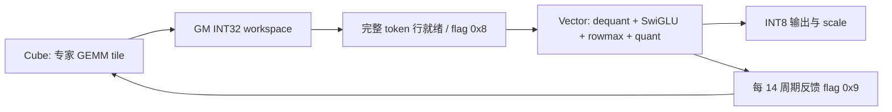

# 把 MoE 专家计算接成 CV 流水：A2/A3 上的 GroupedMatmul + SwiGLU + INT8 动态量化

本案例分析 CANN **9.0.0 正式发布标签 `v9.0.0`** 中的 `GroupedMatmulSwigluQuantV2`，只研究 **Atlas A2 / A3** 上的 **A8W8、FRACTAL_NZ 权重、TilingKey=3** 路径。重点是专家负载调度、Cube 与 Vector 的同步，以及整行动态量化带来的切分约束。

这是可逐行核对的实际内核案例。本文没有公开的优化前后耗时，也没有在 NPU 上运行；因此不提供未经证实的加速倍数。保留的源码、依赖说明及复现入口分别见 [原始源码](../code/upstream/)、[复现记录](reproduce.md)、[来源与证据](sources.md)。

## 1. 版本与硬件先划清

官方 [CANN 9.0.0 发布说明](https://gitcode.com/cann/release-management/blob/c847330e202fbe9e724ef36c6219e49f42cda312/9.0.0/release-notes.md) 将 `cann-ops-transformer 9.0.0` 对应到 `v9.0.0`，并明确配套 CANN 9.0.0。本文固定该标签解析出的完整提交：

```text
afe72144f9f2ac8441929035795db88a111b30c5
```

[算子产品表](https://gitcode.com/cann/ops-transformer/blob/afe72144f9f2ac8441929035795db88a111b30c5/gmm/grouped_matmul_swiglu_quant_v2/README.md) 列出 A2 / A3 训练和推理系列；[算子注册](../code/upstream/gmm/grouped_matmul_swiglu_quant_v2/op_host/grouped_matmul_swiglu_quant_v2_def.cpp) 的第 82–83 行实际注册 `ascend910b` 和 `ascend910_93`。A2 的构建参数是 `ascend910b`，A3 是 `ascend910_93`，不应把两个编译目标都写成 910B。

同一个算子还存在 950 的 MXFP8/MXFP4 实现。本文不使用 `arch35/`，也不把那些数据类型或性能结论套到 A2/A3。支持 CANN 9.0.0，并不表示这份源码可以与任意后续 CANN 版本混编；升级时仍需选择官方配套标签。

## 2. 融合的边界：专家 GEMM 的后处理，而非整个 MoE

路由已经把 token 按专家连续排好，`groupList` 给出每个专家的 token 区间。该算子只处理下列计算：

```text
X_int8 × W_int8_NZ
    → INT32 累加结果
    → per-token activation scale × per-channel weight scale
    → split 成 activation / gate 两半
    → SwiGLU
    → 每 token 求 abs-max、计算 scale、舍入到 INT8
```

它不负责路由、Dispatch、Combine 或跨机通信。DeepSeek 等 MoE 的专家 FFN 第一层包含这类计算，因此本案例有直接的 MoE 应用背景；这里分析的是上游通用专家算子实现，没有声称 DeepSeek 官方独立发表了本内核的 A/B 成绩。

令专家 `e` 有 `M_e` 个 token，输入为 `[M_e,K]`，矩阵乘输出为 `[M_e,N]`。反量化后分成宽度 `N/2` 的两部分：

\[
C_e=(X_eW_e)\odot s^x_e\odot s^w_e,\qquad
S_e=\operatorname{SiLU}(C_{e,act})\odot C_{e,gate}
\]

\[
s^y_t=\max_j|S_{t,j}|/127,\qquad
Y_{t,j}=\operatorname{round}(S_{t,j}/s^y_t)
\]

输出是 `[M,N/2]` 的 INT8 数据和 `[M]` 的 FP32 scale。逐 token 最大值的范围是**完整的输出行**，这一点决定 Vector 不能随便拿一个 GEMM 的 N 子块直接独立量化。

## 3. 专家负载不均：把 tile 扁平化后轮转分核

在 [fusion tiling](../code/upstream/gmm/grouped_matmul_swiglu_quant_v2/op_host/op_tiling/grouped_matmul_swiglu_quant_v2_fusion_tiling.cpp) 中，Cube 基本块固定为：

| 参数 | 实际值 | 作用 |
| --- | ---: | --- |
| `baseM` | 128 | 每块最多 128 token |
| `baseN` | 256 | 每块 256 个输出列 |
| `baseK` | 128 | L0 的 K 基本分块 |
| `stepKa / stepKb` | 4 / 4 | L1 单次搬运覆盖 4 个 K 基本块 |
| `depthA1 / depthB1` | 8 / 8 | 分配两份 L1 数据深度，支持搬运与计算交错 |
| `dbL0C` | 1 | L0C 缓冲配置 |

专家对应的基本块数为：

\[
B_e=\lceil M_e/128\rceil\cdot\lceil N/256\rceil.
\]

[`Init`、`FindCurrentGroup`、`ProcessCubeBlock`](../code/upstream/gmm/grouped_matmul_swiglu_quant_v2/op_kernel/grouped_matmul_swiglu_quant_spilit_fusion.h) 先统计所有专家的基本块，再将它们映射到同一个全局基本块序列。`CubeProcess` 从 `GetBlockIdx()` 开始，每完成一个块就加 `cubeBlockDim`，相当于按块轮转派发给所有 Cube 核。

这比“一个专家固定给一个核”更能处理 token 数不均的场景：大专家拥有更多 tile，可以由多个核处理；零 token 专家产生零个 M tile，不会为了它单独启动矩阵乘。代价是小专家依旧受 M=128 基本块的尾块效率影响，扁平调度不能让一个只有 1 token 的 tile 变成满载。

具体映射由 `FindCurrentGroup` 还原专家编号和全局 M 偏移，`CalculateBlockSizes` 处理 M/N 尾块，`SetupMatmulWeight` 切换该专家的 NZ 权重地址。权重支持一个 5 维张量 `[E,N/32,K/16,16,32]`，也支持多个 4 维专家张量；这是真实存储布局要求，不能只改 ND 张量的 shape 当作 NZ 转换。

## 4. CV 流水为什么要等“整行的 N 块”

`ProcessCubeBlock` 用 `mm.IterateAll<false>` 把 INT32 结果写入 GM workspace。Cube 的基本块顺序包含完整 N 方向的多个 tile；`CubeProcess` 根据 `nBasicsBlocks` 与核数计算 `cvTimes`，推进到一批足够处理的行后，用 `CrossCoreSetFlag<0x2,PIPE_FIX>(0x8)` 通知 Vector。

`VectorProcess → ProcessVectorBlock → ProcessGroupRange → ProcessDSQ` 使用相同的基本块计数还原已就绪的完整 token 行，并跨专家边界拆分区间。`ProcessDSQ` 第一次消费这一批数据时等待 `0x8`，再执行 `SyncAll<true>()`。即使某个 Vector 核没有分到有效行，它仍会参与需要的同步，避免其他核等待不到它。

这组同步保护的是两项具体依赖：

1. Cube 的 Fixpipe 写入完成后，Vector 才能从 workspace 读取 INT32 结果。
2. Vector 的逐行最大值必须看到该行所有 `N/2` 个 SwiGLU 输出，不能拿半行的最大值作为整行量化 scale。

实现还每 `VC_SYNC_MAX_TIMES=14` 个同步周期使用 `0x9` 回传消费进度，Cube 等待、Vector 设置标志。这个限流对应实际 flag 计数与生产消费约束，不能删掉后假定剩余的算术结果仍然可靠。

下面是依赖示意，图中“下一批”能否完全隐藏当前批的 Vector 时间，需要 profiler 验证：



## 5. 后处理融合的实质：UB 内连续完成算术

`ProcessDSQ` 的读入对象是同一批 token 的完整 INT32 行、逐 token scale 和该专家逐通道 scale。它在 UB 中完成：

- INT32 转 FP32，乘两类反量化 scale；专家不变化时用 `weightCacheGroupId_` 复用 weight scale，减少重复加载。
- 根据 tiling 中的 activation/gate 偏移拆成两半，用 `Exp、Adds、Div、Mul` 计算 SwiGLU。
- 将另一半临时区域复用为 abs 值和最大值归约缓冲；先用 `ComputeReduceMax` 折叠 64 元素段，再用 `WholeReduceMax` 得到逐行最大值。
- 计算 `scale=max/127`，广播 scale，执行除法与 `CAST_RINT → half → int8` 转换，最终只写 INT8 数据和 FP32 scale。

这里的关键收益来源是**反量化、SwiGLU、动态量化之间的中间浮点张量不再逐阶段落到 HBM**，同时减少独立算子的提交次数。它并没有把 GEMM 的 INT32 中间结果完全留在片上：那份 workspace 仍然被 Cube 写入并被 Vector 读回。

`InitBuffer` 给 Vector 输入、scale 和输出队列设置的深度是 **1**。不能把这个案例描述成“所有 Vector 队列都 Double Buffer”；明确的双缓冲证据来自 Cube 的 L1 depth 参数。若想继续优化 Vector 搬运重叠，需要先测量、再修改 UB 预算与队列深度。

## 6. 为什么输出宽度大时每次反而减少 token 行数

fusion tiling 将 `ubFactorDimy` 设为 `N/2`，并按矩阵乘输出宽度调整 UB 中的行数：

| GEMM 输出宽度 N | `ubFactorDimx` | 实际含义 |
| --- | ---: | --- |
| N < 4600 | 4 | 每批最多处理 4 行 |
| 4600 ≤ N < 8192 | 2 | 每批最多处理 2 行 |
| N ≥ 8192 | 1 | 每批最多处理 1 行 |

例如 N=4096 / 6144 / 8192 分别落到 4 / 2 / 1 行。因为每一行必须同时容纳整行 INT32 输入、FP32 临时数据、权重 scale 和量化输出，增加宽度会迅速吃掉 UB。这个选择可保证完整行归约，但也让超宽形状的 Vector 循环次数增多。

另一个明确成本是 `workspaceSize=M*N*sizeof(int32_t)+20MiB`。以 M=8192、N=4096 为例，INT32 部分为 **128MiB**，加扩展 workspace 共 **148MiB**。融合减少了后处理浮点张量流量，仍保留这份内存成本；这是评估本实现时应量化的取舍。

## 7. 学习与测量时最容易误用的上游样例

[A8W8 aclnn 样例](../code/upstream/gmm/grouped_matmul_swiglu_quant_v2/examples/test_aclnn_grouped_matmul_swiglu_quant_v2_a8w8.cpp) 声明 M=8192、N=4096、K=7168、E=4，却使用 cumsum `groupList={1,2,2,3}`。因此只覆盖**前 3 个有效 token**，第 2 个专家为空，其余输出不代表有效计算结果。

该样例可检查 API 调用与空专家处理，不能直接当成“8192 token 的吞吐 benchmark”。真正测试满量需要把 groupList 最后一个元素设为 M，并生成实际 NZ 数据、随机输入和 scale；数值比对只覆盖有效 token。动态量化的全零输入、非有限值和舍入边界也应按 API 契约独立检查，不能从这个全 1 样例推断所有边界都覆盖了。

建议以相同专家分布对比“GroupedMatmul + 独立 dequant/SwiGLU/动态量化”与融合版本，分别记录算子 Device 时间、整体四阶段时间、workspace 大小及 MTE2/FIX/Vector 的利用率。至少覆盖均衡分布、一个专家占多数、含空专家，以及 M/N 尾块。公开 A/B 数字未找到，本地结果应连同硬件 SoC、CANN 和提交一同发布。

## 8. 可以直接复用的经验

本实现给出了三个可迁移到其他融合算子的具体模式：**按专家 tile 统一派发**解决不均匀任务；**以完整归约行作为 CV 消费单元**保证动态量化正确性；**在同一份 UB 中复用中间区域**压缩融合后处理的空间开销。是否适合你的 shape，取决于 tail 比例、N 宽度与 Vector 是否成为瓶颈，复现流程见 [reproduce.md](reproduce.md)。
