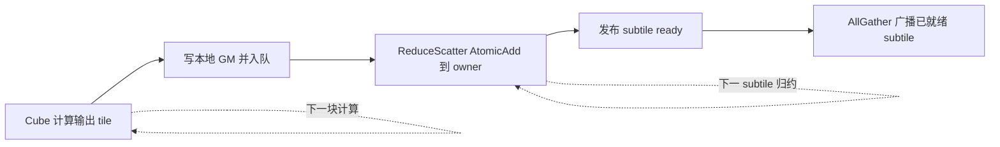

# 在 910B 上优化 GEMM 与 AllReduce 的算子流水

这个案例计算每个 rank 的局部矩阵乘，再对局部结果求和：`C = sum(A_rank × B)`。优化发生在融合算子内部，由一个 Cube kernel 和一个 Vector kernel共同完成。核心变化是让完成的矩阵块立即进入通信，再把 ReduceScatter 与 AllGather 的衔接粒度缩小到 subtile，减少计算和通信之间的等待。

上游在 8 卡 Ascend 910B 上公布了串行路径 `808.9 μs`、流水路径 `560.6 μs`，两者比值约 `1.443×`。这是一份同时包含实现、性能对照和失败尝试的案例。版本方面，上游变更记录明确写明兼容 CANN 9.0.0；性能表没有记录测量时的 CANN 精确版本，因此这些数字属于上游 910B 参考结果。[原始案例](https://github.com/hw-native-sys/pto-isa/blob/15a9e0a0845955f5d7a409a7f4d1609a263b5d25/kernels/manual/a2a3/gemm_ar/README_zh.md)

## 工作量和分块

输入为 FP16，原始维度 `M=5416, K=6144, N=1408`。为了使用固定大小的输出 tile，M 和 N 分别 pad 到 5504 和 1536。每块输出为 `128×256`，因此共有 `43×6=258` 块。参考配置分配 24 个计算 block 和 24 个通信 block；这里的 24 是该算子的配置，不是对所有 910B 型号核数的统一描述。[配置源码](../code/upstream/kernels/manual/a2a3/gemm_ar/gemm_ar_config.h)

每个 rank 独立计算完整的 `A_rank × B`。不要把总吞吐按 rank 数扩大后当成单芯片吞吐，也不要把本算子的时延换成模型 TPOT。

## Cube 内部先形成稳定流水

`gemm_compute_kernel.cpp` 用 L1 缓存和 L0 双缓冲组织矩阵乘。`baseM=128, baseK=64, baseN=256` 对应 FP16 的 L0A 面板 16 KiB、L0B 面板 32 KiB。`stepKa=stepKb=4` 让一次 GM 到 L1 的搬运覆盖四个 K slice，随后逐个抽取到 L0，减少 DMA 启动次数。此处的四倍是搬运调用频率的变化，不是四倍时延收益。

`SwizzleTileIndex` 改变输出块的遍历顺序，试图提高相邻任务的输入复用。一个 tile 算完后，FixPipe 把累加结果转换成 FP16 并写到本地 GM，再发布 tile 就绪信息。AIV 不需要等待整张输出矩阵完成。[计算内核](../code/upstream/kernels/manual/a2a3/gemm_ar/gemm_compute_kernel.cpp)

## 从整张矩阵同步改为逐块通知

每个 AIC 拥有一个生产者队列。通信 block 静态接管若干队列；当计算和通信 block 数相等时形成一对一关系，通信 block 较少时则轮询自己的队列集合。生产者先写 slot，再发布 count，消费者先检查 count，再读取 slot。队列及其缓存可见性处理可在 `ready_queue.hpp` 中逐行检查。

这种设计把跨核同步放到数据真正可用的位置。它仍有本地 GM 中转：`gemm_output` 保存 Cube 输出，通信阶段再读取。不能将它描述成没有 GM 中间张量的融合。[队列实现](../code/upstream/kernels/manual/a2a3/gemm_ar/ready_queue.hpp)

## 用 subtile 就绪信号衔接通信

一个 `128×256` 输出块继续沿 M 轴切成两个 `64×256` subtile。ReduceScatter 把各 rank 的贡献通过 AtomicAdd 直接累加到 owner rank，省去独立的本地 Reduce 阶段。AllGather 只需要等待自己负责的 subtile 收齐所有 rank 的贡献，无须等全局 ReduceScatter 结束。

`RsPublishSubtileReady` 在发布 ready counter 前执行 `pipe_barrier` 和 `dsb`，把数据可见性与通知顺序绑定起来。`AgDrainReadyAssignedSubtiles` 检查计数达到 `nranks` 后执行 acquire，再搬运已经完成的 subtile。`ag-summary` 提供较粗粒度的唤醒信息，避免没有工作时一直扫描全部 ready counter。这些同步是协议的正确性条件，不能因为想减少等待就直接删除。[通信内核](../code/upstream/kernels/manual/a2a3/gemm_ar/comm_kernel.cpp)

## 性能对照与回退实验

| 对照路径 | 上游参考耗时 |
| --- | ---: |
| Compute only | 368.1 μs |
| GEMM 后再运行通信 | 808.9 μs |
| 双流流水 | 560.6 μs |

按展示值计算，流水路径减少约 248.3 μs，即 30.7%。原文显示的节省值为 248.4 μs，存在 0.1 μs 的舍入差异。

历史优化记录中，Block Swizzle 为 `808 → 793 μs`，RS AtomicAdd 为 `793 → 736 μs`，AG 工作分解为 `736 → 623 μs`。尝试更多 AIV 后得到 639 μs 和 667 μs，上游将其归因为计算侧干扰并回退。这个反例说明，通信并行度也会受到共享带宽和调度资源限制。

这些历史检查点不是当前版本中的独立开关。当前源码能直接比较串行和流水路径；若要重现每个历史阶段，需要对应的历史源码与相同环境，不能从本快照推导各改动的独立收益。

## 计时与精度需要保留的边界

`main.cpp` 对串行和并发路径分别做 5 次预热，正式测量各 10 次。融合总时间来自 Host 墙钟，覆盖启动到相关流同步；流水中显示的 compute done 则使用设备 Event。两种计时口径不同，不宜直接用它们估算 Cube 利用率。[计时实现](../code/upstream/kernels/manual/a2a3/gemm_ar/main.cpp)

源码最终额外执行的是串行路径，并只在 rank 0 上做结果检查。`VerifyOutput` 使用 `atol=1.0, rtol=0.01`，且允许最多约 1% 元素超过这一逐元素阈值。这个验收标准较宽，也不能单凭它认定所有 rank 的并发路径已被严格校验。工程使用时应补充每个 rank 的流水输出对拍，并按实际应用精度要求检查误差分布。

## 复现实验

先保持参考 shape 和 24 个计算 block，逐项改变通信 block 数、base tile 和 stepK，每次记录串行及流水耗时、误差、CANN 和驱动版本。小 shape 可能被固定调度成本主导，大 shape 则可能暴露通信或 HBM 竞争，结论必须随规格记录。

[复现步骤](reproduce.md)提供固定 commit 的获取、编译和运行入口；[来源记录](sources.md)列出版本、硬件、性能和授权依据。
